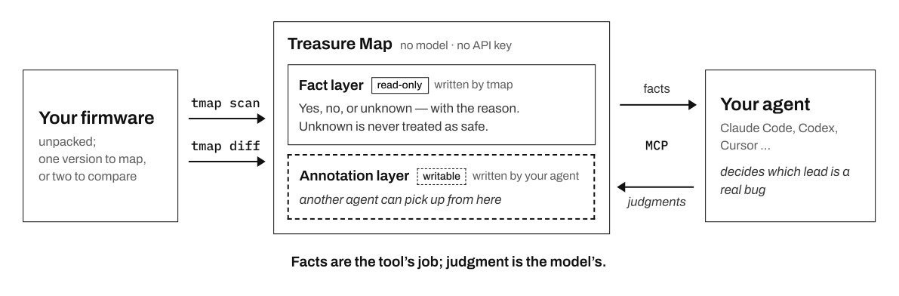

<div align="center">

# Treasure Map: A firmware map for your AI agent

**English** | [中文](https://github.com/JoeyZzZzZz/treasure-map/blob/main/README.zh.md)

### Treasure Map draws the map; your agent finds the treasure.

[](https://pypi.org/project/tmap-agents/)
[](https://pypi.org/project/tmap-agents/)
[](https://github.com/JoeyZzZzZz/treasure-map#connect-your-agent)
[](https://github.com/JoeyZzZzZz/treasure-map/blob/main/LICENSE)

[**Website**](https://tmap.tools/) · [**Showcase**](https://tmap.tools/showcase/) · [**Blog**](https://tmap.tools/blog/) · [**Quick start**](#quick-start)

</div>

Treasure Map turns an unpacked firmware filesystem into a map your coding agent (Claude Code,
Codex, Cursor and others) reads through a bundled MCP server: every place the compiled code runs a
shell command, copies into a buffer, formats a string or opens a file by path, where the data
reaching each one comes from, and what could not be determined. Give it two versions and it shows
what the update changed around those calls.

It runs no model and needs no API key. Every fact points at an exact binary, function and address;
deciding which lead is a real bug is your agent's job.

**Facts are the tool's job; judgment is the model's.**



## Why your agent needs a map

A modern agent reads one function well. What it cannot do on its own is cover a whole root
filesystem (a hundred binaries, tens of thousands of functions) the same way twice, or tell you
what it never looked at. So it stops after the first few leads, or reports "nothing found" for
code it never read.

Treasure Map does that half. It lays out every lead with the facts behind it, keeps count of what
has been read and judged, and says plainly where it is blind. Your agent does the reading and the
judging, and its conclusions are kept for the next session.

## What it does

### Map one firmware

`tmap scan` decompiles every binary with Ghidra and marks each call that runs a shell command,
copies into a buffer, formats a string or opens a file by path. Every candidate carries the same
layers: where its data comes from, how much of it an attacker controls, who wrote the value, how
the spot is reached, whether anything filters it, and whether the function was fully analyzed.
Each layer reads **YES**, **NO** or an explicit **UNKNOWN** that says what is missing and why.

There is no score. The default view puts the highest-impact calls that nothing has proven safe
first; your agent can re-sort or filter by any layer, and the set of candidates stays the same.
Only a proven-safe fact can push a candidate down; an UNKNOWN never can. Command-execution,
buffer-copy and format-string calls come with in-function argument provenance; path and file calls
are detected and ranked, and their controllability comes from a text-level reading, marked as
such.

### Diff two versions

`tmap diff` compares every binary whose content changed, running Ghidra, BinExport and BinDiff end
to end in parallel; you never handle an intermediate file. Each changed function pair is grouped
by what happened around its dangerous calls, so your agent reads the few changes that matter
instead of thousands of functions, and answers: is this a security fix, which weakness in the old
version does it close, is it complete, and does the same call survive elsewhere?

- **What a similarity score misses.** BinDiff can read `similarity=1.0` while a buffer length went
  from `0x40` to `0x3f`. Treasure Map compares address-normalized pseudocode and flags a changed
  length constant at a copy or format call.
- **A review that knows what it skipped.** The server picks the must-read changes, hands them out
  in work units and counts what has been judged. An unread change stays *unread*, never "nothing
  found", and the review is not called complete before the must-read list is done.
- **Scripts and configs too.** Non-binary files are compared by path, and each one can be judged.

### Keep what your agent concluded

Judgments go into an annotation layer over the read-only facts, so a multi-session audit picks up
where it left off, with any model or agent. A judgment is flagged for review again the moment the
facts under it change.

## Case studies

### CVE-2021-26614 was “fixed”. The backdoor never left.

In 2021 ipTIME patched CVE-2021-26614, a debug backdoor in its C200 IP camera (firmware 1.058 →
1.060). We gave that patch to DeepSeek-V4.1-Flash, a budget general-purpose model, with Treasure
Map and the diff prompt from Quick start. It judged every must-read item and found three changes
that look like security fixes; not one of them finishes the job:

- **The backdoor was unlinked, not removed.** Its handler, hardcoded token and command execution
  are still in the latest firmware, 1.094 (June 2026).
- **The buffer got bigger, not safer.** The copy into it still takes a length the client decides.
- **Validation was added only in the browser.** The server CGI is byte-identical in both versions.

**4 of 110 binaries changed · 144 of 144 must-read items judged · US$0.5–1 per run**

[Read the full case study →](https://tmap.tools/showcase/iptime-c200-patch-diff/)

## Quick start

> **Developer preview.** Commands, config, the atlas database and MCP tool fields may change
> incompatibly between versions; see Upgrading below.

**1. Install.** One command installs `tmap`, then runs `tmap init`: it sets up the toolchain (JDK
21, Ghidra 11.4.3, BinExport, BinDiff 8, reusing what you already have), registers the MCP server
with the agents you pick and installs the diff-review skill for those that read skills. Restart
your agent when it finishes.

```bash
curl -LsSf https://github.com/JoeyZzZzZz/treasure-map/releases/latest/download/install.sh | sh
```

**2. Map a firmware.** The input is an *already-extracted* filesystem (unpack the image with any
tool you like, or ask your agent to). `-w` is the name you give it.

```bash
tmap scan ./firmware.extracted -w my-fw
```

Then ask your agent:

```text
Audit firmware my-fw with Treasure Map.
End with the leads worth following up, each with its evidence_ref and why.
```

**3. Diff two versions.**

```bash
tmap scan ./fw_v1.extracted -w fw-v1
tmap scan ./fw_v2.extracted -w fw-v2
tmap diff --before fw-v1 --after fw-v2
```

Then ask your agent:

```text
Review the firmware diff fw-v1 → fw-v2 with Treasure Map:
find the security fixes, judge whether each one is complete,
and check whether the new code adds attack surface.
```

The prompts only say what you want. How to work through a map or a diff (what to read, how to
record each judgment, when a review may stop) comes from Treasure Map itself: its MCP instructions
and the diff-review skill. A whole firmware pair is often more than one agent session holds: a
fresh session continues where the last one stopped.

`scan` is the slow part: one Ghidra pass per binary, with progress shown. Re-running with the same
`-w` resumes where it stopped. Everything you scan and diff accumulates in one **atlas**
(`~/.treasure-map/atlas.db`), and your agent picks which firmware or diff to work on.

## Day to day

| Command | What it does |
|---|---|
| `tmap scan DIR -w NAME` | Map one extracted firmware (run it again to resume) |
| `tmap diff --before A --after B` | Diff two scanned versions (`--binary NAME` for one binary) |
| `tmap runs` | List the firmware you scanned, and which ones the installed version would redo |
| `tmap rescan [NAME ...]` | Re-scan the runs the installed version would produce differently (`--dry-run` lists them) |
| `tmap doctor` | Check the toolchain, config and agent registrations (changes nothing) |
| `tmap update` | Install the newest version, then run its `tmap init` |
| `tmap uninstall` | Remove what `tmap init` installed; your data stays |

## Install details

`tmap init` installs the toolchain into `~/.treasure-map/toolchain/`, or reuses what you already
have if it passes the checks. Downloads come from pinned URLs and are checked against a pinned
size and sha256 before anything is unpacked. It shows what it found and what it will download,
and changes nothing until you confirm; `--dry-run` prints the full plan.

| Tool | Version | Used for |
|---|---|---|
| **JDK** | 21 (a JDK, not a JRE) | running Ghidra (JDK 11/17 make Ghidra 11.4.3 fail to launch) |
| **Ghidra** | 11.4.3 | decompiling every binary, headless |
| **BinExport** | for Ghidra 11.4.3 | exporting binaries for `tmap diff` |
| **BinDiff** | 8 | matching functions between two versions |

| Platform | Status |
|---|---|
| Linux x86_64 (including WSL2) | supported |
| macOS on Apple Silicon | supported |
| macOS on Intel | runs the same toolchain; not acceptance-tested |
| Linux arm64, native Windows | not supported (no Ghidra decompiler / BinDiff build); on Windows use WSL2 |

## Connect your agent

`tmap init` registers the MCP server with the agents you pick (Claude Code, Codex, Cursor, Claude
Desktop, dsh; the ones it finds are pre-selected) and installs the diff-review skill where the
agent reads skills from disk. Restart the agent afterwards. Claude Desktop takes skills only as an
upload: save the output of `tmap review skill` as `tmap-diff-review/SKILL.md`, zip that folder and
upload it under Customize > Skills (code execution must be on).

<details>
<summary>Registering the MCP server by hand</summary>

The command is always `<absolute path of tmap> mcp` (`command -v tmap` prints the path).

| Agent | Register |
|---|---|
| **Claude Code** | `claude mcp add -s user treasure-map -- "$(command -v tmap)" mcp` |
| **Codex** | `codex mcp add treasure-map -- "$(command -v tmap)" mcp` |
| **Cursor / Claude Desktop / other JSON clients** | add the block below to the client's MCP config file |
| **dsh** | `tmap init --client dsh` adds the entry to `$DSH_HOME/cordis.patch.yml` (default `~/.dsh`), the layer every profile reads |

```json
{
  "mcpServers": {
    "treasure-map": {
      "command": "/absolute/path/to/tmap",
      "args": ["mcp"]
    }
  }
}
```

Config files: Cursor `~/.cursor/mcp.json`; Claude Desktop
`~/Library/Application Support/Claude/claude_desktop_config.json` (macOS); Windsurf
`~/.codeium/windsurf/mcp_config.json`; Gemini CLI `~/.gemini/settings.json`. With Claude Code use
`-s user`: a project-local entry of the same name hides it inside that project (`tmap doctor`
points such entries out).

Parameter names, what each means and where it differs between tools:
`get_tool_reference(name="parameters")`.

</details>

## Upgrading

```bash
tmap update                                 # install the newest version, then run its init
tmap rescan                                 # re-scan every run the new code would redo
tmap diff --before fw-v1 --after fw-v2      # re-run a diff; out-of-date runs are rescanned first
```

`tmap update` checks PyPI, shows its plan and asks once (`--check` only reports, `--yes` skips the
question). It names any other `tmap` on PATH that would shadow the new one, then starts the new
version's `tmap init` by itself, which says how many of your runs predate it; `tmap runs` shows
which. A diff made by an older version, or with another toolchain, is recomputed once. To rescan a
single firmware, name its run (the `-w` name, unless you set `--run-id`): `tmap rescan fw-v1`.

`tmap update` works on the install the one-line installer makes (`uv tool`). Installed another
way, update it the same way you installed it.

## Troubleshooting

Run `tmap doctor` first. Each check shows ✅, ⚠ (works, worth knowing), `·` (information), ❌, or
`?` (could not be determined, never shown as ✅); it exits non-zero on any ❌ or `?`.

- **`tmap: command not found`**: the tool's bin directory is not on PATH. Run
  `uv tool update-shell`, then open a new shell.
- **`ghidra` / `java` / `bindiff` ❌**: run `tmap init` again for the pinned download, or pass
  `--ghidra / --java-home / --bindiff PATH`. On WSL keep everything on the Linux side, not under
  `/mnt/c/...`.
- **`binexport` ❌ "two copies"**: Ghidra loads extensions from both its own `Ghidra/Extensions`
  and its user settings directory; remove one of the two.
- **A binary is missing from a diff**: ask your agent for `list_diff_blindspots`, which names
  every binary the diff could not analyze and why. After fixing a toolchain problem,
  `tmap diff … --force-retry` tries them again.
- **Your own Ghidra 11.4.3 starts with an unexpected JDK**: Ghidra remembers the JDK it last ran
  with (`java_home.save` in its settings directory), and Treasure Map's runs record the JDK they
  use there. Set `JAVA_HOME` when you start Ghidra yourself.

## Uninstalling

```bash
tmap uninstall
```

It shows its plan, asks once, then removes the treasure-map entry and the diff-review skill from
each agent, removes the toolchain `tmap init` downloaded (never a JDK, Ghidra or BinDiff you
installed yourself), and offers to remove the program itself. **Your data stays:**
`~/.treasure-map/config.yaml`, `.env`, the atlas and the workspaces; reinstalling reuses all of
it.

<details>
<summary>Deleting your data too, and other details</summary>

- `tmap uninstall --purge-data` deletes the data too, after you type a confirmation phrase (not
  recoverable), but only what is provably Treasure Map's: the atlas, what a scan wrote in each
  workspace directory holding a Treasure Map `analysis.db`, and the `config.yaml` / `.env` that
  `tmap init` wrote. The workspace base itself stays (unless it is the default inside
  `~/.treasure-map` and left empty), and nothing in it is deleted when it is your home directory
  or above it. Anything else, such as a file you wrote yourself in a workspace or beside one, is
  kept and listed.
- An agent entry named treasure-map that does not run `tmap` is left alone, and so is one inside
  a dsh profile's own file.
- The program is removed with `uv tool uninstall tmap-agents` when it was installed with
  `uv tool`; installed another way, `tmap uninstall` tells you to remove it the same way.
- `--dry-run` prints the plan and changes nothing; `--yes` skips the questions, but never the
  confirmation phrase.

</details>

## Intended use & legal

**Purpose.** Treasure Map supports defensive security auditing and vulnerability research on
firmware. It produces analysis leads; by design it does **not** generate proof-of-concept exploits,
payloads, shellcode, or other directly weaponizable output.

**Lawful use is yours to ensure.** Only analyze firmware you lawfully possess — a device you own, or
firmware made genuinely public by its vendor and obtained **without** bypassing any login, paywall
or access control. Even lawfully obtained firmware may carry license, terms-of-service or contractual
restrictions on reverse engineering; you are responsible for reviewing them.

**Findings are candidates, not verdicts.** Output requires independent human verification and is not
a confirmed vulnerability.

**No warranty.** The tool is provided "as is". You are solely responsible for how you use it and for
ensuring your activity is lawful in your jurisdiction. If unsure, consult qualified legal counsel.

## Security

To report a vulnerability in Treasure Map itself, please do it privately: see
[SECURITY.md](https://github.com/JoeyZzZzZz/treasure-map/blob/main/SECURITY.md). A vulnerability
you find in firmware *with* Treasure Map belongs to that device's vendor.

## Contributing

Issues and pull requests are welcome; see
[CONTRIBUTING.md](https://github.com/JoeyZzZzZz/treasure-map/blob/main/CONTRIBUTING.md).

## License

[Apache-2.0](https://github.com/JoeyZzZzZz/treasure-map/blob/main/LICENSE).
