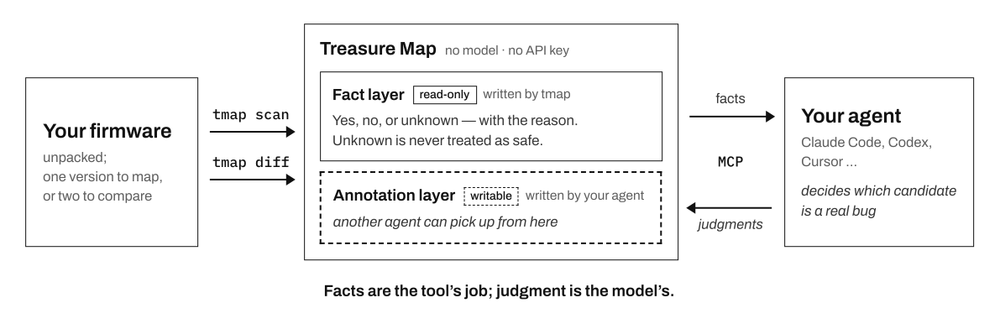

<!-- mcp-name: io.github.JoeyZzZzZz/treasure-map -->

<div align="center">

# Treasure Map: A firmware map for your AI agent

**English** | [中文](https://github.com/JoeyZzZzZz/treasure-map/blob/main/README.zh.md)

### Treasure Map draws the map; your agent finds the treasure.

[](https://pypi.org/project/tmap-agents/)
[](https://registry.modelcontextprotocol.io/?q=io.github.JoeyZzZzZz%2Ftreasure-map)
[](https://pypi.org/project/tmap-agents/)
[](https://github.com/JoeyZzZzZz/treasure-map/blob/main/LICENSE)

[**Quick start**](#quick-start) · [**Website**](https://tmap.tools/) · [**Showcase**](https://tmap.tools/showcase/) · [**Blog**](https://tmap.tools/blog/)

</div>

Treasure Map runs a full static analysis of an unpacked firmware and finds four kinds of dangerous
call sites: command execution, memory copies, format strings and file paths. For each call site it
records facts such as where the arguments come from, how controllable they are and how the call is
reached, and it marks explicitly what it could not determine. Given two firmware versions, it
produces a function-level patch diff.

Your agent queries these facts over MCP and decides its own path through the analysis. The tool
runs no model, needs no API key and gives no vulnerability verdicts: the tool supplies the facts,
and the model makes the judgment.



## Why an agent needs a map

Agents read a single function well. Given a whole root filesystem (a hundred binaries, tens of
thousands of functions), they tend to stop after the first few candidates and report "nothing found"
for code they never read.

Some questions can't be answered by looking at one binary:

- **Who writes the value?** A setting one program reads, such as an nvram key, is often written by
  another program. The map lists which programs write and read each nvram key, and whether it can
  be set from the web interface.
- **Who starts the program?** Web servers hand work to helper programs, and init scripts decide
  which daemons run. The map records which binaries and scripts launch each program, with symlinks
  such as `/bin/sh → busybox` resolved.
- **What hasn't been read?** Progress is counted against every candidate in the firmware, and each
  function or binary that could not be fully analyzed is named, so "nothing found" and "never read"
  stay apart.
- **What did the update change?** Given two firmware versions, the map finds every binary and file
  that changed, scripts, configs and web pages included, and the binaries that exist in only one
  version. A patch spread across several files is seen in full.

The agent does the reading and judging. Treasure Map tracks what has been read and judged, and the
conclusions carry over to the next session.

## What it does

### Map one firmware

`tmap scan` decompiles every binary with Ghidra and marks each of those calls. Every candidate gets
the same layers: where its data comes from, how much of it an attacker controls, who wrote the
value, how the call is reached, whether anything filters it, and whether the function was fully
analyzed. Each layer is **YES**, **NO** or **UNKNOWN**, and an UNKNOWN says what is missing and
why.

There is no score. By default, the highest-impact calls that nothing has proven safe come first.
Your agent can sort or filter by any layer; the candidate set stays the same. Only a fact proving a
call safe can move it down. An UNKNOWN never does.

Command-execution, buffer-copy and format-string calls include in-function argument provenance.
Path and file calls are detected and ranked, but their controllability comes from a text-level
reading and is labeled that way.

### Diff two versions

`tmap diff` compares, in parallel, every binary whose content changed between the two versions.
Ghidra, BinExport and BinDiff run automatically from start to finish, you never touch an
intermediate file, and the result is a function-level patch diff. Changed function pairs are grouped by what changed around
those calls, so your agent reads the few changes that matter instead of thousands of functions. For
each one it answers: is this a security fix, which weakness in the old version does it close, is
the fix complete, and does the same call remain elsewhere?

- BinDiff can report `similarity=1.0` when a buffer length changed from `0x40` to `0x3f`. Treasure
  Map also compares address-normalized pseudocode and flags changed length constants at copy and
  format calls.
- The server picks the must-read changes, hands them out in work units and counts how many have
  been judged. An unread change is reported as unread, not as "nothing found", and the review is
  not complete until every must-read item is judged.
- Scripts and config files are compared by path, and each one can be judged.

### Keep the agent's conclusions

Judgments are stored in an annotation layer on top of the read-only facts, so an audit can continue
across sessions, models and agents. When the facts under a judgment change, the judgment is flagged
for review.

## Case studies

### CVE-2021-26614 was "fixed". The backdoor code never left.

In 2021 ipTIME patched CVE-2021-26614, a debug backdoor in its C200 IP camera (firmware 1.058 →
1.060). We gave that patch to DeepSeek-V4.1-Flash, a low-cost general-purpose model, along with
Treasure Map and the diff prompt from Quick start. It judged every must-read item and found three
changes that look like security fixes. None of them is complete:

- **The backdoor was unlinked, not removed.** Its handler, hardcoded token and command execution
  are still in the latest firmware, 1.094 (June 2026).
- **The buffer got bigger, not safer.** The copy into it still uses a length the client chooses.
- **Validation was added only in the browser.** The server-side CGI is byte-identical in both
  versions.

**4 of 110 binaries changed · 144 of 144 must-read items judged · US$0.5–1 per run**

[Read the full case study →](https://tmap.tools/showcase/iptime-c200-patch-diff/)

## Quick start

> **Developer preview.** Commands, config, the atlas database and MCP tool fields may change
> incompatibly between versions. See [Upgrading](#upgrading).

**1. Install.** This installs `tmap` and then runs `tmap init`, which sets up the toolchain,
registers the MCP server with the agents you choose, and installs the diff-review skill for agents
that read skills. Restart your agent when it finishes.

```bash
curl -LsSf https://github.com/JoeyZzZzZz/treasure-map/releases/latest/download/install.sh | sh
```

**2. Map a firmware.** The input is an *already-extracted* filesystem; unpack the image with any
tool, or have your agent do it. `-w` gives it a name.

```bash
tmap scan ./firmware.extracted -w my-fw
```

Then ask your agent:

```text
Audit firmware my-fw with Treasure Map.
End with the candidates worth following up, each with its evidence_ref and why.
```

**3. Diff two versions.**

```bash
tmap scan ./fw_v1.extracted -w fw-v1
tmap scan ./fw_v2.extracted -w fw-v2
tmap diff --before fw-v1 --after fw-v2
```

Then ask your agent:

```text
Review the firmware diff fw-v1 → fw-v2 with Treasure Map:
find the security fixes, judge whether each one is complete,
and check whether the new code adds attack surface.
```

The prompts only say what you want. The MCP server's instructions and the diff-review skill tell
the agent how to work: what to read, how to record each judgment, and when the review may stop. A
firmware pair often takes more than one agent session; a new session picks up where the last one
stopped.

`scan` is the slow step: one Ghidra pass per binary, with progress shown. Re-run with the same `-w`
to resume. Everything you scan and diff goes into one **atlas** (`~/.treasure-map/atlas.db`), and
your agent chooses which firmware or diff to work on.

## Day to day

| Command | What it does |
|---|---|
| `tmap scan DIR -w NAME` | Map one extracted firmware (run again to resume) |
| `tmap diff --before A --after B` | Diff two scanned versions (`--binary NAME` for one binary) |
| `tmap runs` | List scans and diffs, show which are out of date, and delete them (`--delete`) |
| `tmap rescan [NAME ...]` | Re-scan runs left out of date by an upgrade (`--dry-run` lists them) |
| `tmap doctor` | Check the toolchain, config and agent registrations (changes nothing) |
| `tmap update` | Install the newest version, then run its `tmap init` |
| `tmap uninstall` | Remove what `tmap init` installed; your data stays |

## Install details

### Platforms

| Platform | Status |
|---|---|
| Linux x86_64, including WSL2 | ✅ Supported |
| macOS on Apple Silicon | ✅ Supported |
| macOS on Intel | ❔ Same toolchain, not acceptance-tested |
| Linux arm64, native Windows | ❌ Not supported: no Ghidra decompiler or BinDiff build. On Windows, use WSL2 |

### Toolchain

`tmap init` installs these into `~/.treasure-map/toolchain/`, or reuses your own copies if they
pass its checks.

| Tool | Used for |
|---|---|
| **JDK 21** | Running Ghidra. It must be a JDK, not a JRE; Ghidra 11.4.3 fails to launch on JDK 11/17 |
| **Ghidra 11.4.3** | Decompiling every binary, headless |
| **BinExport** (for Ghidra 11.4.3) | Exporting binaries for `tmap diff` |
| **BinDiff 8** | Matching functions between two versions |

### Setup

- Downloads come from pinned URLs and are checked against a pinned size and sha256 before anything
  is unpacked.
- `tmap init` shows what it found and what it will download, and changes nothing until you confirm.
  `--dry-run` only prints the plan.

## Connect your agent

`tmap init` registers the MCP server with the agents you choose (Claude Code, Codex, Cursor, Claude
Desktop, dsh; the ones it detects are pre-selected) and installs the diff-review skill for agents
that load skills from disk. Restart the agent afterwards.

Claude Desktop only accepts skills as uploads: save the output of `tmap review skill` as
`tmap-diff-review/SKILL.md`, zip the folder, and upload it under Customize > Skills (code execution
must be on).

<details>
<summary>Registering the MCP server by hand</summary>

The command is always `<absolute path of tmap> mcp` (`command -v tmap` prints the path).

| Agent | Register |
|---|---|
| **Claude Code** | `claude mcp add -s user treasure-map -- "$(command -v tmap)" mcp` |
| **Codex** | `codex mcp add treasure-map -- "$(command -v tmap)" mcp` |
| **dsh** | `tmap init --client dsh` adds the entry to `$DSH_HOME/cordis.patch.yml` (default `~/.dsh`), the layer every profile reads |
| **Cursor / Claude Desktop / other JSON clients** | add the block below to the client's MCP config file |

```json
{
  "mcpServers": {
    "treasure-map": {
      "command": "/absolute/path/to/tmap",
      "args": ["mcp"]
    }
  }
}
```

Config files: Cursor `~/.cursor/mcp.json`; Claude Desktop
`~/Library/Application Support/Claude/claude_desktop_config.json` (macOS); Windsurf
`~/.codeium/windsurf/mcp_config.json`; Gemini CLI `~/.gemini/settings.json`. With Claude Code, use
`-s user`: a project-local entry with the same name overrides it inside that project (`tmap doctor`
flags these).

Parameter names, their meanings and how they differ between tools:
`get_tool_reference(name="parameters")`.

</details>

## Upgrading

```bash
tmap update                                 # install the newest version, then run its init
tmap rescan                                 # re-scan every run the upgrade left out of date
tmap diff --before fw-v1 --after fw-v2      # re-run a diff; out-of-date runs are rescanned first
```

`tmap update` checks PyPI, shows its plan and asks once (`--check` only reports; `--yes` skips the
prompt). It warns about any other `tmap` on PATH that would shadow the new one, then runs the new
version's `tmap init`, which reports how many of your runs predate it (`tmap runs` lists them). A
diff made by an older version or another toolchain is recomputed once. To rescan one firmware, pass
its run name (the `-w` name, unless you set `--run-id`): `tmap rescan fw-v1`.

`tmap update` works for installs made by the one-line installer (`uv tool`). If you installed
another way, update the same way.

## Troubleshooting

Start with `tmap doctor`. It checks the toolchain, the config and the agent registrations, changes
nothing, and exits non-zero on any ❌ or `?`.

✅ passed · ⚠ works, worth knowing · `·` info · ❌ failed · `?` could not tell (never shown as ✅)

| Problem | Fix |
|---|---|
| `tmap: command not found` | Its bin directory is not on PATH: run `uv tool update-shell`, then open a new shell. |
| `ghidra`, `java` or `bindiff` ❌ | Run `tmap init` again, or point to your own with `--ghidra`, `--java-home` or `--bindiff PATH`. On WSL, keep everything off `/mnt/c/...`. |
| `binexport` ❌ "two copies" | Ghidra loads one from `Ghidra/Extensions` and one from its user settings directory. Remove either. |
| A binary is missing from a diff | Ask your agent for `list_diff_blindspots` to see why, then rerun with `tmap diff … --force-retry`. |
| Your own Ghidra 11.4.3 picks an unexpected JDK | Treasure Map's runs update its `java_home.save`. Set `JAVA_HOME` when you launch Ghidra yourself. |

## Uninstalling

```bash
tmap uninstall
```

It shows its plan and asks once, then removes the treasure-map entry and the diff-review skill from
each agent, removes the toolchain `tmap init` downloaded (never a JDK, Ghidra or BinDiff you
installed yourself), and offers to remove the program itself. **Your data stays:**
`~/.treasure-map/config.yaml`, `.env`, the atlas and the workspaces. Reinstalling reuses all of it.

<details>
<summary>Deleting your data too, and other details</summary>

- `tmap uninstall --purge-data` also deletes your data after you type a confirmation phrase. This
  cannot be undone. It deletes only what is provably Treasure Map's: the atlas, what a scan wrote
  in each workspace directory holding a Treasure Map `analysis.db`, and the `config.yaml` / `.env`
  that `tmap init` wrote. The workspace base itself is kept (unless it is the default one inside
  `~/.treasure-map` and is left empty), and nothing in it is deleted if it is your home directory
  or above. Anything else, such as a file you put in or next to a workspace, is kept and listed.
- An agent entry named treasure-map that does not run `tmap` is left alone, as is one inside a dsh
  profile's own file.
- If the program was installed with `uv tool`, it is removed with `uv tool uninstall tmap-agents`.
  Otherwise `tmap uninstall` tells you to remove it the way you installed it.
- `--dry-run` prints the plan and changes nothing. `--yes` skips the questions, but never the
  confirmation phrase.

</details>

## Intended use & legal

**Purpose.** Treasure Map supports defensive security auditing and vulnerability research on
firmware. It produces analysis leads; by design it does **not** generate proof-of-concept exploits,
payloads, shellcode, or other directly weaponizable output.

**Lawful use is yours to ensure.** Only analyze firmware you lawfully possess: a device you own, or
firmware made genuinely public by its vendor and obtained **without** bypassing any login, paywall
or access control. Even lawfully obtained firmware may carry license, terms-of-service or
contractual restrictions on reverse engineering; you are responsible for reviewing them.

**Findings are candidates, not verdicts.** Output requires independent human verification and is not
a confirmed vulnerability.

**No warranty.** The tool is provided "as is". You are solely responsible for how you use it and for
ensuring your activity is lawful in your jurisdiction. If unsure, consult qualified legal counsel.

## Security

To report a vulnerability in Treasure Map itself, please do it privately: see
[SECURITY.md](https://github.com/JoeyZzZzZz/treasure-map/blob/main/SECURITY.md). A vulnerability
you find in firmware *with* Treasure Map belongs to that device's vendor.

## Contributing

Issues and pull requests are welcome; see
[CONTRIBUTING.md](https://github.com/JoeyZzZzZz/treasure-map/blob/main/CONTRIBUTING.md).

## License

[Apache-2.0](https://github.com/JoeyZzZzZz/treasure-map/blob/main/LICENSE).
