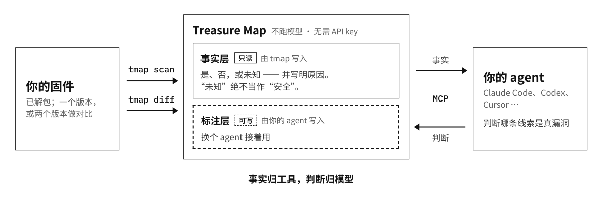

<div align="center">

# Treasure Map：给 AI agent 的固件藏宝图

[English](https://github.com/JoeyZzZzZz/treasure-map/blob/main/README.md) | **中文**

### 地图标出地形，宝藏由你的 agent 去挖。

[](https://pypi.org/project/tmap-agents/)
[](https://pypi.org/project/tmap-agents/)
[](https://github.com/JoeyZzZzZz/treasure-map/blob/main/README.zh.md#连接你的-agent)
[](https://github.com/JoeyZzZzZz/treasure-map/blob/main/LICENSE)

[**官网**](https://tmap.tools/zh/) · [**案例**](https://tmap.tools/zh/showcase/) · [**博客**](https://tmap.tools/zh/blog/) · [**快速开始**](#快速开始)

</div>

Treasure Map 把解包后的固件文件系统画成一张地图，通过内置的 MCP 服务器交给你的编程 agent（Claude
Code、Codex、Cursor 等）：编译后的代码里每一处执行 shell 命令、拷贝内存缓冲区、格式化字符串、按路径打开文件的地方，流到那里的数据从哪来，以及哪些没能查清。给它两个版本，它会标出这次更新在这些调用附近改了什么。

它不运行任何模型，也不需要 API key。每条事实都指向具体的二进制、函数和地址；哪条线索是真漏洞，由你的 agent 来定。

**事实归工具，判断归模型。**



## 为什么 agent 需要一张地图

现在的 agent 已经很擅长读懂一个函数。它自己做不到的，是把整个根文件系统（上百个二进制、几万个函数）每次都按同样的方式过一遍，并且说清自己哪里没看。于是它常常看完头几条线索就下结论，或者对根本没读过的代码报"没发现问题"。

这一半由 Treasure Map 来做：它把每条线索连同背后的事实摆出来，记下哪些已经读过、判过，并如实说明自己哪里看不到。读代码和下判断交给你的 agent，它的结论会留给下一次会话。

## 它做什么

### 给一个固件画地图

`tmap scan` 用 Ghidra 反编译每个二进制，标出每一处执行 shell 命令、拷贝内存缓冲区、格式化字符串、按路径打开文件的调用。每个候选都带着同样的几张图层：数据从哪来，攻击者能控制多少，这个值是谁写的，怎么走到这里，路上有没有过滤，这个函数有没有分析完整。每张图层只有三种状态：**是**、**否**，或者明确的**未知**；"未知"会写明缺什么、为什么没查到。

没有分数。默认视图把影响最大、又没有任何事实证明安全的调用排在最前；agent 可以按任意图层重新排序或筛选，候选集合不变。只有**已证明安全**的事实能让候选下沉，"未知"永远不会。命令执行、内存拷贝、格式化字符串这三类调用带有函数内的参数来源分析；路径和文件类调用目前只做检测和排序，它们的可控性来自文本层面的读取，并会如实标明。

### 对比两个版本

`tmap diff` 并行对比所有内容有变化的二进制，从 Ghidra、BinExport 到 BinDiff 全程自动完成，你不用碰任何中间文件。每对改动过的函数按危险调用附近发生了什么分组，agent 不用在几千个函数里大海捞针，只需读真正要紧的那几处改动，回答：这是不是一次安全修复，它修掉的是旧版本里的哪个弱点，修得完不完整，同样的调用是不是还留在别处？

- **相似度看不到的改动。** BinDiff 可能显示 `similarity=1.0`，而缓冲区长度已经从 `0x40` 改成了 `0x3f`。Treasure Map 额外比较地址归一化后的伪代码，并标出拷贝或格式化调用处被改动的长度常量。
- **知道自己漏了什么的审查。** 服务器挑出必读的改动，按工作单元分发，并统计判过了多少。没读的改动就是"未读"，绝不算"没发现问题"；必读清单没读完，审查就不算完成。
- **脚本和配置也比。** 非二进制文件按路径对比，每个文件都可以单独判断。

### 留住 agent 的结论

判断存放在只读事实之上的标注层里，多次会话的审计可以从上次停下的地方继续，换模型、换 agent 都一样。底层事实一旦变化，压在上面的判断会被重新标为待复核。

## 案例

### CVE-2021-26614“已修复”，后门还在固件里

2021 年，ipTIME 在 C200 IP 摄像头的固件 1.060 里修复了调试后门漏洞 CVE-2021-26614。我们把这次补丁（1.058 → 1.060）交给廉价的通用模型 DeepSeek-V4.1-Flash，配上 Treasure Map 和快速开始里那段 diff 提示词。它把必读条目逐条判完，找出三处看起来像安全修复的改动，没有一处修完：

- **后门只是断开了入口，没有删掉。** 处理函数、硬编码的 token 和命令执行，到最新的 1.094（2026 年 6 月）都还在。
- **缓冲区加大了，并没有更安全。** 往里拷贝的长度仍由客户端决定。
- **校验只加在浏览器里。** 服务器端的 CGI 两个版本逐字节相同。

**110 个二进制里改了 4 个 · 144 个必读条目全部判完 · 每次 ¥3.55–7.57**

[阅读完整案例 →](https://tmap.tools/zh/showcase/iptime-c200-patch-diff/)

## 快速开始

> **开发者预览版。** 命令、配置文件、atlas 数据库和 MCP 工具的字段，在版本之间可能出现不兼容的变化；升级方法见下文"升级"一节。

**1. 安装。** 一条命令装好 `tmap`，随后自动运行 `tmap init`：它会配置工具链（JDK 21、Ghidra 11.4.3、BinExport、BinDiff 8，已经装好的直接复用），把 MCP 服务器注册到你选择的 agent，并给能读取 skill 的 agent 装上 diff 审查 skill。完成后重启你的 agent。

```bash
curl -LsSf https://github.com/JoeyZzZzZz/treasure-map/releases/latest/download/install.sh | sh
```

**2. 给一个固件画地图。** 输入是**已经解包**的文件系统（用你习惯的工具解包，或者让 agent 来解）。`-w` 是你给这个固件起的名字。

```bash
tmap scan ./firmware.extracted -w my-fw
```

然后对你的 agent 说：

```text
用 Treasure Map 审计固件 my-fw。
最后列出值得跟进的线索，每条附上 evidence_ref 和理由。
```

**3. 对比两个版本。**

```bash
tmap scan ./fw_v1.extracted -w fw-v1
tmap scan ./fw_v2.extracted -w fw-v2
tmap diff --before fw-v1 --after fw-v2
```

然后对你的 agent 说：

```text
用 Treasure Map 审查固件对比 fw-v1 → fw-v2：
找出其中的安全修复，判断每处修得是否完整，
并检查新代码有没有引入新的攻击面。
```

提示词只需要说清你要什么。怎么读地图、怎么审对比（该读哪些、每个判断怎么记录、什么时候才能停），由 Treasure Map 自己告诉 agent：MCP 服务器的说明和 diff 审查 skill。一对固件的审查常常超出一次 agent 会话的容量：新会话会从上次停下的地方接着做。

`scan` 是最慢的一步：每个二进制跑一遍 Ghidra，会显示进度；用同一个 `-w` 重新运行会从中断处继续。你扫过、比过的所有结果都积累在同一个 **atlas**（`~/.treasure-map/atlas.db`）里，由 agent 自己选择看哪个固件、哪次对比。

## 日常命令

| 命令 | 作用 |
|---|---|
| `tmap scan DIR -w NAME` | 给一个已解包的固件画地图（再运行一次即可续跑） |
| `tmap diff --before A --after B` | 对比两个扫描过的版本（`--binary NAME` 只比一个二进制） |
| `tmap runs` | 列出扫过的固件，以及当前安装的版本会重做哪些 |
| `tmap rescan [NAME ...]` | 重新扫描当前版本会扫出不同结果的 run（`--dry-run` 只列出不运行） |
| `tmap doctor` | 检查工具链、配置和 agent 注册情况（不做任何改动） |
| `tmap update` | 装上最新版本，再运行它的 `tmap init` |
| `tmap uninstall` | 移除 `tmap init` 装的东西；你的数据会保留 |

## 安装细节

`tmap init` 把工具链装到 `~/.treasure-map/toolchain/`；你已有的版本只要通过检查，就直接复用。所有下载都来自固定的 URL，解压前会校验固定的文件大小和 sha256。它会列出找到了什么、要下载什么，在你确认之前不会做任何改动；`--dry-run` 会打印完整计划。

| 工具 | 版本 | 用途 |
|---|---|---|
| **JDK** | 21（必须是 JDK，不是 JRE） | 运行 Ghidra（用 JDK 11/17 时 Ghidra 11.4.3 无法启动） |
| **Ghidra** | 11.4.3 | 无界面反编译每个二进制 |
| **BinExport** | 对应 Ghidra 11.4.3 | 为 `tmap diff` 导出二进制 |
| **BinDiff** | 8 | 在两个版本之间匹配函数 |

| 平台 | 状态 |
|---|---|
| Linux x86_64（含 WSL2） | 支持 |
| Apple Silicon 的 macOS | 支持 |
| Intel 的 macOS | 使用同一套工具链，未做验收测试 |
| Linux arm64、原生 Windows | 不支持（没有 Ghidra 反编译器 / BinDiff 的构建）；Windows 请用 WSL2 |

## 连接你的 agent

`tmap init` 会把 MCP 服务器注册到你选择的 agent（Claude Code、Codex、Cursor、Claude Desktop、dsh；检测到的会预先勾选），并在会从磁盘读取 skill 的 agent 里装上 diff 审查 skill。注册后重启 agent 即可。Claude Desktop 只能通过上传添加 skill：把 `tmap review skill` 的输出存为 `tmap-diff-review/SKILL.md`，把这个文件夹打成 zip，在 Customize > Skills 里上传（需要开启代码执行）。

<details>
<summary>手动注册 MCP 服务器</summary>

命令始终是 `<tmap 的绝对路径> mcp`（`command -v tmap` 可以打印路径）。

| Agent | 注册方式 |
|---|---|
| **Claude Code** | `claude mcp add -s user treasure-map -- "$(command -v tmap)" mcp` |
| **Codex** | `codex mcp add treasure-map -- "$(command -v tmap)" mcp` |
| **Cursor / Claude Desktop / 其他 JSON 配置的客户端** | 把下面这段加到客户端的 MCP 配置文件 |
| **dsh** | `tmap init --client dsh` 会把条目写进 `$DSH_HOME/cordis.patch.yml`（默认 `~/.dsh`），所有 profile 都会读取这一层 |

```json
{
  "mcpServers": {
    "treasure-map": {
      "command": "/absolute/path/to/tmap",
      "args": ["mcp"]
    }
  }
}
```

配置文件位置：Cursor `~/.cursor/mcp.json`；Claude Desktop
`~/Library/Application Support/Claude/claude_desktop_config.json`（macOS）；Windsurf
`~/.codeium/windsurf/mcp_config.json`；Gemini CLI `~/.gemini/settings.json`。Claude Code 请用
`-s user`：项目内同名的本地条目会在该项目里覆盖它（`tmap doctor` 会指出这类条目）。

各参数名的含义、以及它们在不同工具之间的差别：`get_tool_reference(name="parameters")`。

</details>

## 升级

```bash
tmap update                                 # 装上最新版本，再运行它的 init
tmap rescan                                 # 重新扫描新代码会扫出不同结果的所有 run
tmap diff --before fw-v1 --after fw-v2      # 重新运行对比；过期的 run 会先重扫
```

`tmap update` 会到 PyPI 查询最新版本，展示计划并询问一次（`--check` 只报告不安装，`--yes` 跳过询问）。如果 PATH 上还有别的 `tmap` 会遮住新版本，它会指出来；随后自动启动新版本的 `tmap init`，这次 init 会告诉你有多少个 run 早于新版本，具体是哪些用 `tmap runs` 查看。旧版本或其他工具链生成的对比，会重新计算一次。只想重扫某一个固件，就写上它的 run 名（默认就是扫描时用的 `-w` 名字，除非你另外设置了 `--run-id`），例如 `tmap rescan fw-v1`。

`tmap update` 适用于一键安装脚本装好的版本（`uv tool`）。如果是用其他方式安装的，请用同样的方式升级。

## 故障排查

先运行 `tmap doctor`。每项检查会显示 ✅、⚠（能用，但值得注意）、`·`（提示信息）、❌，或 `?`（无法判定，绝不会显示成 ✅）；出现任何 ❌ 或 `?` 时，退出码不为零。

- **`tmap: command not found`**：工具的 bin 目录不在 PATH 里。运行 `uv tool update-shell`，然后打开一个新的 shell。
- **`ghidra` / `java` / `bindiff` ❌**：再运行一次 `tmap init` 获取固定版本的下载，或者传入
  `--ghidra / --java-home / --bindiff PATH`。在 WSL 上，所有东西都要放在 Linux 一侧，不要放在
  `/mnt/c/...` 下。
- **`binexport` ❌ "two copies"**：Ghidra 会同时从自己的 `Ghidra/Extensions` 和用户设置目录加载扩展；删掉其中一份即可。
- **某个二进制没出现在对比结果里**：让 agent 调用 `list_diff_blindspots`，它会列出每个没能分析的二进制及原因。修好工具链问题后，`tmap diff … --force-retry` 会重新尝试这些二进制。
- **你自己启动的 Ghidra 11.4.3 用了意料之外的 JDK**：Ghidra 会记住上次运行时用的 JDK（设置目录里的
  `java_home.save`），而 Treasure Map 运行时会把它使用的 JDK 记在那里。自己启动 Ghidra 时请设置 `JAVA_HOME`。

## 卸载

```bash
tmap uninstall
```

它会先展示计划并询问一次，然后从每个 agent 中移除 treasure-map 条目和 diff 审查 skill，删除 `tmap init` 下载的工具链（绝不会删除你自己安装的 JDK、Ghidra 或 BinDiff），并询问是否卸载程序本身。**你的数据会保留：** `~/.treasure-map/config.yaml`、`.env`、atlas 和各个工作区，重新安装后全部可以继续使用。

<details>
<summary>连数据一起删除，以及其他细节</summary>

- `tmap uninstall --purge-data` 会把数据一并删除，需要你输入确认短语（不可恢复），但只删能证明属于 Treasure Map 的：atlas、含 Treasure Map `analysis.db` 的工作区目录里扫描写下的文件，以及 `tmap init` 写的 `config.yaml` / `.env`。工作区根目录本身不删（它是 `~/.treasure-map` 里的默认目录且已经空了时除外）；根目录是你的家目录或更上层时一个都不删。其他东西，比如你自己写的文件，不论在工作区里还是旁边，都会保留并列出。
- 名为 treasure-map、但运行的不是 `tmap` 的 agent 条目不会被动，dsh profile 自己文件里的条目也不会被动。
- 如果程序是用 `uv tool` 安装的，会用 `uv tool uninstall tmap-agents` 卸载；用其他方式安装的，`tmap uninstall` 会提示你用同样的方式卸载。
- `--dry-run` 只打印计划，不做任何改动；`--yes` 跳过提问，但不会跳过确认短语。

</details>

## 用途与法律声明

**用途。** Treasure Map 用于固件的防御性安全审计和漏洞研究。它产出的是分析线索；按设计，它**不会**生成漏洞利用 PoC、payload、shellcode 或其他可直接武器化的输出。

**合法使用由你自己负责。** 只分析你合法持有的固件：你自己拥有的设备，或由厂商真正公开发布、且获取时
**没有**绕过任何登录、付费墙或访问控制的固件。即使是合法获取的固件，也可能受许可证、服务条款或合同中关于逆向工程的限制约束，你需要自行确认。

**结果是候选，不是结论。** 输出需要独立的人工验证，不代表确认的漏洞。

**无担保。** 本工具按"原样"提供。你对自己的使用方式、以及你的活动在所在司法辖区是否合法负全部责任。如有疑问，请先咨询合格的法律顾问。

## 安全

要报告 Treasure Map 自身的漏洞，请私下报告，见 [SECURITY.md](https://github.com/JoeyZzZzZz/treasure-map/blob/main/SECURITY.md)。你**借助** Treasure Map 在固件里发现的漏洞，请报告给对应的设备厂商。

## 参与贡献

欢迎提交 issue 和 pull request，详见 [CONTRIBUTING.md](https://github.com/JoeyZzZzZz/treasure-map/blob/main/CONTRIBUTING.md)。

## 许可证

[Apache-2.0](https://github.com/JoeyZzZzZz/treasure-map/blob/main/LICENSE)。
