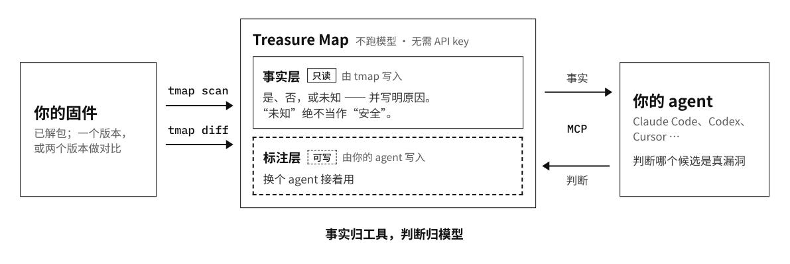

<div align="center">

# Treasure Map：给 AI agent 的固件藏宝图

[English](https://github.com/JoeyZzZzZz/treasure-map/blob/main/README.md) | **中文**

### 地图标出地形，宝藏由你的 agent 去挖。

[](https://pypi.org/project/tmap-agents/)
[](https://pypistats.org/packages/tmap-agents)
[](https://registry.modelcontextprotocol.io/?q=io.github.JoeyZzZzZz%2Ftreasure-map)
[](https://pypi.org/project/tmap-agents/)
[](https://github.com/JoeyZzZzZz/treasure-map/blob/main/LICENSE)

[**快速开始**](#快速开始) · [**官网**](https://tmap.tools/zh/) · [**案例**](https://tmap.tools/zh/showcase/) · [**博客**](https://tmap.tools/zh/blog/)

</div>

Treasure Map 对解包后的固件做全量静态分析，识别命令执行、内存拷贝、格式化字符串、文件路径四类危险调用点，记录每个调用点的参数来源、可控性、可达性等事实，并显式标注无法确定的部分。输入两个固件版本时，给出函数级的补丁对比结果。

agent 通过 MCP 查询这些事实，自主决定分析路径。工具本身不运行模型，不需要 API key，也不输出漏洞判定：事实由工具提供，判断由模型完成。



## 为什么 agent 需要地图

agent 读懂单个函数已经不成问题。但面对整个根文件系统（上百个二进制、几万个函数），它往往看了前几个候选就收手，对没读过的代码也报“没发现问题”。

有些问题，只看一个二进制回答不了：

- **值是谁写的？** 一个程序读取的配置值（比如 nvram 键），常常是另一个程序写进去的。地图会列出每个 nvram 键由哪些程序写入、哪些程序读取，以及能不能从网页上修改。
- **程序是谁启动的？** Web 服务器常把活交给外部程序，哪些守护进程会跑起来由启动脚本决定。地图记录了每个程序由哪些二进制和脚本启动，`/bin/sh → busybox` 这类符号链接也已解析。
- **哪些还没读？** 进度按固件里的全部候选统计，没能完整分析的函数和二进制会逐个列出，“没发现问题”和“根本没读”不会混在一起。
- **更新改了什么？** 对比两个固件版本时，地图会找出所有改动过的二进制和文件（包括脚本、配置和网页），以及只在一个版本里存在的二进制。补丁的改动分散在几个文件里，也能一次看全。

读代码、下判断由 agent 完成。Treasure Map 记录哪些已读、已判，结论会留到下一次会话。

## 功能

### 扫描单个固件

`tmap scan` 用 Ghidra 反编译每个二进制，标出上述几类调用。每个候选都有同样几层信息：数据来源、攻击者能控制多少、值由谁写入、怎么走到这里、中间有没有过滤、所在函数是否分析完整。每一层的结果只有**是**、**否**、**未知**三种，“未知”会写明缺什么、为什么。

没有评分。默认排序把影响最大、又没有事实证明安全的调用放在最前。agent 可以按任意一层重新排序或筛选，候选集合不变。只有“已证明安全”的事实能让候选往后排，“未知”不能。

命令执行、缓冲区拷贝、格式化字符串三类调用带有函数内的参数来源分析。路径和文件类调用目前只做检测和排序，可控性来自文本层面的读取，结果里会注明。

### 对比两个版本

`tmap diff` 并行对比两个版本里所有内容有变化的二进制，Ghidra、BinExport、BinDiff 全程自动完成，不用碰中间文件，最后给出函数级的补丁对比。改动过的函数对按这些调用附近的变化分组，agent 只需读几处关键改动，不用翻几千个函数，然后回答：这是不是安全修复？修的是旧版本里哪个弱点？修完整了吗？同样的调用在别处还有没有？

- BinDiff 可能给出 `similarity=1.0`，而缓冲区长度其实已从 `0x40` 改成 `0x3f`。Treasure Map 会再比较地址归一化后的伪代码，标出拷贝和格式化调用处改动过的长度常量。
- 服务器选出必读改动，按工作单元分发，并统计判过多少。没读的改动标为“未读”，不算“没发现问题”；必读清单没判完，审查就不算完成。
- 脚本和配置文件按路径对比，每个文件都可以单独判断。

### 保存 agent 的结论

判断存放在只读事实之上的标注层里，审计可以跨会话继续，换模型、换 agent 都行。判断所依据的事实一旦变化，该判断会被标为待复核。

## 案例

### CVE-2021-26614“已修复”，但后门代码一直都在

2021 年，ipTIME 在 C200 IP 摄像头固件 1.060 中修复了调试后门漏洞 CVE-2021-26614。我们把这次补丁（1.058 → 1.060）交给低价通用模型 DeepSeek-V4.1-Flash，配合 Treasure Map 和快速开始里的 diff 提示词。它判完了全部必读条目，找出三处像是安全修复的改动，但没有一处修完整：

- **后门只是断开了入口，代码没删。** 处理函数、硬编码 token 和命令执行在最新的 1.094（2026 年 6 月）里都还在。
- **缓冲区加大了，并没有更安全。** 拷贝长度仍由客户端决定。
- **校验只加在了浏览器端。** 服务器端 CGI 两个版本逐字节相同。

**110 个二进制里改了 4 个 · 144 个必读条目全部判完 · 每次 ¥3.55–7.57**

[阅读完整案例 →](https://tmap.tools/zh/showcase/iptime-c200-patch-diff/)

## 快速开始

> **开发者预览版。** 命令、配置、atlas 数据库和 MCP 工具字段在版本之间可能不兼容，见下文[升级](#升级)。

**1. 安装。** 一条命令装好 `tmap` 并自动运行 `tmap init`：配置工具链，把 MCP 服务器注册到你选择的 agent，并为能读取 skill 的 agent 装上 scan 审查和 diff 审查两个 skill。完成后重启 agent。

```bash
curl -LsSf https://github.com/JoeyZzZzZz/treasure-map/releases/latest/download/install.sh | sh
```

**2. 扫描一个固件。** 输入是**已解包**的文件系统，用你习惯的工具解包，或者让 agent 来解。`-w` 是给它起的名字。

```bash
tmap scan ./firmware.extracted -w my-fw
```

然后对 agent 说：

```text
用 Treasure Map 审计固件 my-fw。
最后列出值得跟进的候选，每个附上 evidence_ref 和理由。
```

**3. 对比两个版本。**

```bash
tmap scan ./fw_v1.extracted -w fw-v1
tmap scan ./fw_v2.extracted -w fw-v2
tmap diff --before fw-v1 --after fw-v2
```

然后对 agent 说：

```text
用 Treasure Map 审查固件对比 fw-v1 → fw-v2：
找出其中的安全修复，判断每处修得是否完整，
并检查新代码有没有引入新的攻击面。
```

提示词只需说清你要什么。怎么读地图、怎么审对比（读哪些、怎么记录判断、什么时候能停），由 MCP 服务器的说明和审查 skill 告诉 agent。一对固件往往一个会话审不完，新会话会接着上次的进度做。

`scan` 最耗时：每个二进制跑一遍 Ghidra，会显示进度。用同一个 `-w` 重新运行即可续跑。所有扫描和对比结果都存在同一个 **atlas**（`~/.treasure-map/atlas.db`）里，由 agent 自己选择处理哪个固件、哪次对比。

## 日常命令

| 命令 | 作用 |
|---|---|
| `tmap scan DIR -w NAME` | 扫描一个已解包的固件（再运行一次即续跑） |
| `tmap diff --before A --after B` | 对比两个扫描过的版本（`--binary NAME` 只比一个二进制） |
| `tmap runs` | 列出扫描和对比、标出哪些已过期，并可删除（`--delete`） |
| `tmap rescan [NAME ...]` | 重扫因工具升级而过期的 run（`--dry-run` 只列出） |
| `tmap doctor` | 检查工具链、配置和 agent 注册情况（不做改动） |
| `tmap update` | 装上最新版本，再运行它的 `tmap init` |
| `tmap uninstall` | 移除 `tmap init` 装的东西，数据保留 |

## 安装细节

### 平台

| 平台 | 状态 |
|---|---|
| Linux x86_64（含 WSL2） | ✅ 支持 |
| Apple Silicon 的 macOS | ✅ 支持 |
| Intel 的 macOS | ❔ 工具链相同，未做验收测试 |
| Linux arm64、原生 Windows | ❌ 不支持：没有 Ghidra 反编译器和 BinDiff 的构建。Windows 请用 WSL2 |

### 工具链

`tmap init` 把这些工具装到 `~/.treasure-map/toolchain/`；你已有的版本只要通过检查，就直接复用。

| 工具 | 用途 |
|---|---|
| **JDK 21** | 运行 Ghidra。必须是 JDK，不是 JRE；JDK 11/17 下 Ghidra 11.4.3 无法启动 |
| **Ghidra 11.4.3** | 无界面反编译每个二进制 |
| **BinExport**（对应 Ghidra 11.4.3） | 为 `tmap diff` 导出二进制 |
| **BinDiff 8** | 在两个版本之间匹配函数 |

### 安装过程

- 所有下载都来自固定的 URL，解压前会校验固定的文件大小和 sha256。
- `tmap init` 会先列出找到了什么、要下载什么，你确认之前不做任何改动；`--dry-run` 只打印计划。

## 连接你的 agent

`tmap init` 会把 MCP 服务器注册到你选择的 agent（Claude Code、Codex、Cursor、Claude Desktop、dsh；检测到的默认勾选），并为从磁盘读取 skill 的 agent 装上 scan 审查和 diff 审查两个 skill。注册后重启 agent。

Claude Desktop 只能通过上传添加 skill：把 `tmap review skill --scan` 的输出存为 `tmap-scan-review/SKILL.md`、`tmap review skill` 的输出存为 `tmap-diff-review/SKILL.md`，把每个文件夹分别打成 zip，在 Customize > Skills 里上传（需要开启代码执行）。

<details>
<summary>手动注册 MCP 服务器</summary>

命令始终是 `<tmap 的绝对路径> mcp`（`command -v tmap` 可以打印路径）。

| Agent | 注册方式 |
|---|---|
| **Claude Code** | `claude mcp add -s user treasure-map -- "$(command -v tmap)" mcp` |
| **Codex** | `codex mcp add treasure-map -- "$(command -v tmap)" mcp` |
| **dsh** | `tmap init --client dsh` 会把条目写进 `$DSH_HOME/cordis.patch.yml`（默认 `~/.dsh`），所有 profile 都会读取这一层 |
| **Cursor / Claude Desktop / 其他 JSON 配置的客户端** | 把下面这段加到客户端的 MCP 配置文件 |

```json
{
  "mcpServers": {
    "treasure-map": {
      "command": "/absolute/path/to/tmap",
      "args": ["mcp"]
    }
  }
}
```

配置文件位置：Cursor `~/.cursor/mcp.json`；Claude Desktop
`~/Library/Application Support/Claude/claude_desktop_config.json`（macOS）；Windsurf
`~/.codeium/windsurf/mcp_config.json`；Gemini CLI `~/.gemini/settings.json`。Claude Code 请用
`-s user`：项目里同名的本地条目会在该项目中覆盖它（`tmap doctor` 会指出这类条目）。

参数名、含义及不同工具之间的差别：`get_tool_reference(name="parameters")`。

</details>

## 升级

```bash
tmap update                                 # 装上最新版本，再运行它的 init
tmap rescan                                 # 重扫因升级而过期的所有 run
tmap diff --before fw-v1 --after fw-v2      # 重新运行对比；过期的 run 会先重扫
```

`tmap update` 会查询 PyPI，展示计划并询问一次（`--check` 只报告，`--yes` 跳过询问）。如果 PATH 上有别的 `tmap` 会遮住新版本，它会指出来，然后自动运行新版本的 `tmap init`，告诉你有多少个 run 早于新版本（具体是哪些用 `tmap runs` 查看）。旧版本或其他工具链生成的对比会重新计算一次。只重扫某一个固件时，写上它的 run 名（默认是扫描时的 `-w` 名，除非另设了 `--run-id`），例如 `tmap rescan fw-v1`。

`tmap update` 只适用于一键安装脚本装的版本（`uv tool`）。用其他方式安装的，请用原来的方式升级。

## 故障排查

先运行 `tmap doctor`。它检查工具链、配置和 agent 注册情况，不做任何改动；出现 ❌ 或 `?` 时退出码不为零。

✅ 通过 · ⚠ 能用但值得注意 · `·` 提示 · ❌ 失败 · `?` 无法判定（绝不显示成 ✅）

| 问题 | 怎么办 |
|---|---|
| `tmap: command not found` | 工具的 bin 目录不在 PATH 里：运行 `uv tool update-shell`，再新开一个 shell。 |
| `ghidra`、`java` 或 `bindiff` ❌ | 再运行一次 `tmap init`，或用 `--ghidra`、`--java-home`、`--bindiff PATH` 指向自己的安装。WSL 上不要放在 `/mnt/c/...` 下。 |
| `binexport` ❌ "two copies" | Ghidra 从 `Ghidra/Extensions` 和用户设置目录各加载了一份，删掉其中一份。 |
| 某个二进制没出现在对比结果里 | 让 agent 调用 `list_diff_blindspots` 查原因，修好后用 `tmap diff … --force-retry` 重试。 |
| 自己启动的 Ghidra 11.4.3 用了意料之外的 JDK | Treasure Map 的运行会改写它的 `java_home.save`。自己启动 Ghidra 时请设置 `JAVA_HOME`。 |

## 卸载

```bash
tmap uninstall
```

它会先展示计划并询问一次，然后从每个 agent 中移除 treasure-map 条目和审查 skill，删除 `tmap init` 下载的工具链（绝不删你自己装的 JDK、Ghidra 或 BinDiff），并询问是否卸载程序本身。**数据会保留：** `~/.treasure-map/config.yaml`、`.env`、atlas 和各个工作区，重新安装后可以直接接着用。

<details>
<summary>连数据一起删除，以及其他细节</summary>

- `tmap uninstall --purge-data` 会连数据一起删，需要输入确认短语，删了无法恢复。它只删能证明属于 Treasure Map 的内容：atlas、含 Treasure Map `analysis.db` 的工作区目录里扫描写下的文件，以及 `tmap init` 写的 `config.yaml` / `.env`。工作区根目录本身保留（它是 `~/.treasure-map` 下的默认目录且已经空了时除外）；根目录是你的家目录或更上层时，里面一个文件都不删。其他文件，比如你自己放在工作区里或旁边的文件，会保留并列出。
- 名为 treasure-map、但运行的不是 `tmap` 的 agent 条目不会动，dsh profile 自己文件里的条目也不会动。
- 用 `uv tool` 安装的程序会通过 `uv tool uninstall tmap-agents` 卸载；用其他方式安装的，`tmap uninstall` 会提示你按原方式卸载。
- `--dry-run` 只打印计划，不做任何改动；`--yes` 跳过提问，但不会跳过确认短语。

</details>

## 用途与法律声明

**用途。** Treasure Map 用于固件的防御性安全审计和漏洞研究。它产出的是分析线索；按设计，它**不会**生成漏洞利用 PoC、payload、shellcode 或其他可直接武器化的输出。

**合法使用由你自己负责。** 只分析你合法持有的固件：你自己拥有的设备，或由厂商真正公开发布、且获取时**没有**绕过任何登录、付费墙或访问控制的固件。即使是合法获取的固件，也可能受许可证、服务条款或合同中关于逆向工程的限制约束，你需要自行确认。

**结果是候选，不是结论。** 输出需要独立的人工验证，不代表确认的漏洞。

**无担保。** 本工具按“原样”提供。你对自己的使用方式、以及你的活动在所在司法辖区是否合法负全部责任。如有疑问，请先咨询合格的法律顾问。

## 安全

要报告 Treasure Map 自身的漏洞，请私下报告，见 [SECURITY.md](https://github.com/JoeyZzZzZz/treasure-map/blob/main/SECURITY.md)。你**借助** Treasure Map 在固件里发现的漏洞，请报告给对应的设备厂商。

## 参与贡献

欢迎提交 issue 和 pull request，详见 [CONTRIBUTING.md](https://github.com/JoeyZzZzZz/treasure-map/blob/main/CONTRIBUTING.md)。

## 许可证

[Apache-2.0](https://github.com/JoeyZzZzZz/treasure-map/blob/main/LICENSE)。
